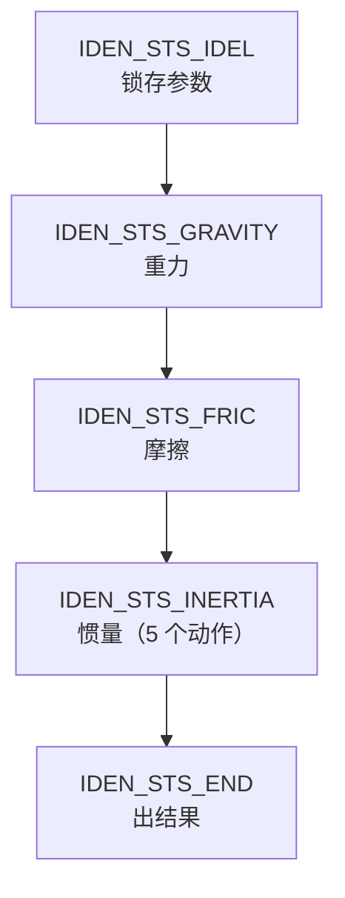

# 负载惯量辨识（Load Identification）流程与计算公式

> [!info] 文档信息
> - **适用固件**：Venus Servo SW（E530）
> - **代码基线**：`HEAD = 67459c1cd` + 工作区改动（摩擦阶段合并了原包装层，并在 `FRIC_STS_END` 内实现 `FRIC_CYCLE_NUM_MAX` 多轮循环）；行号以此为准，源码增删后会漂移，对不上时以符号名为准
> - **主要源文件**：`Application/Common/Source/MotorControl/ControlComponents/Motor/LOADIDEN.{c,h}`、`.../Common/NumericalMethods.c`

---

## 1. 概述

负载辨识（Load Identification，简称 Load ID）用于一次性测出机械负载的四个关键量：

| 输出         | 参数/变量                                                   | 说明                                    |
| ---------- | ------------------------------------------------------- | ------------------------------------- |
| 负载惯量比      | `u32ExtInertiaRatio` → `idx_NVPAR_LoadInertiaRatio`     | 扣除电机本体后，负载/电机惯量比（单位 0.1%，1000 = 100%） |
| 粘滞阻尼（动态摩擦） | `u16LoadDynamicFric`                                    | 由辨识出的阻尼 B 换算                          |
| 正/反向静态摩擦   | `n16LoadPosStaticFric` / `n16LoadNegStaticFric`         | 摩擦力辨识结果                               |
| 重力补偿力矩     | `n32ExtGravity` → `idx_NVPAR_GravityCompensationTorque` | 保持力矩（竖直轴）                             |

**外部入口：**

| 参数                     | Identifier | 取值                                 | 代码                                                  |
| ---------------------- | ---------- | ---------------------------------- | --------------------------------------------------- |
| LoadIdentificationMode | 1085       | Manual / Auto                      | `u16LoadIdenMode`                                   |
| TuningMoveMode         | 1087       | 0=Alternate（交替）, 1=Incremental（单向） | `*pu16MoveMode`（→ `ptAutoTune->tPar.eTuneMoveMode`） |
| TuningMoveDirection    | 1089       | 0=Forward, 1=Backward              | `*pu16Direction` → `bActDir`                        |
| LoadIdenDistRevs       | —          | 单次运行行程                             | `u16LoadIdenDistRevs`                               |
| LoadIdenTorqueLimit    | —          | 力矩限幅                               | `u16LoadIdenTorqueLimit`                            |
| LoadIdenSpeedLimit     | —          | 转速限幅                               | `u16LoadIdenSpeedLimit`                             |
| MechanismType          | —          | 刚性 / 柔性                            | `u16Mechanism`                                      |
| VerticalAxis           | —          | 0=水平, 1=竖直                         | `u16VerticalAxis`                                   |

- 方向 `bActDir` 只在测试开始时读一次（`LOADIDEN_vGetPara`，`LOADIDEN.c:730`），测试中途改变无效。
- 竖直轴被强制为 Alternate 且力矩上限 50%（`VERTICAL_MAX_TOQ = 500`，`LOADIDEN.c:103-137`）。

---

## 2. 总体流程



分发逻辑见 `LOADIDEN_vMainFunction`（`LOADIDEN.c:1167-1283`）：

| 状态 | 调用 | 完成后 |
| --- | --- | --- |
| IDEL | `LOADIDEN_vGetPara` / `vParaSetting` / `vReset`，清零 `tVar`，`u16AvgNum = 1` | → GRAVITY |
| GRAVITY | `LOADIDEN_bGravity` | `n32BaseToqRef` 作为重力力矩 → FRIC |
| FRIC | `LOADIDEN_bFriction`（默认单轮；`FRIC_CYCLE_NUM_MAX > 1` 时重复 N 轮） | 正/反向摩擦、重力修正 → INERTIA |
| INERTIA | `LOADIDEN_bInertia`（`IdenActionSeq[6]`） | → END |
| END | `vAutoWarn` / `vResultUpdate` / 保存 EEPROM，`eLoopCtrlMode = LOAD_CTRL_STOP` | → IDEL，`StateFlag = IDEN_DONE` |

动作序列（`LOADIDEN.c:25-32`）：

```c
const E_IdenAction IdenActionSeq[6] = {
    IDEN_ACT_CYCLE, IDEN_ACT_REPEAT1, IDEN_ACT_REPEAT2,
    IDEN_ACT_REPEAT3, IDEN_ACT_REPEAT4, IDEN_ACT_END
};
```

---

## 3. 各阶段详解

### 3.1 重力辨识（`LOADIDEN_bGravity`，`LOADIDEN.c:392-434`）

1. `GRAVITY_STS_IDEL`：切 `LOAD_CTRL_ZERO_SPD`（零速锁定），力矩置 0。
2. `GRAVITY_STS_WAIT`：等待 `TEST_DELAY_TM = 500 ms`（抱闸/静止）。
3. `GRAVITY_STS_HOLDING`：在 `|spd| < IDEN_MIN_SPD(10 rpm)` 条件下，对实测 Iq（`n32CurToqFdb`）累加 500 ms 后取平均：

```
n32BaseToqRef = Σ n32CurToqFdb / (execFreq × TEST_DELAY_TM / 10)   // = Σ / 4000
```

该值即"维持零速所需力矩" ≈ 重力（水平轴≈0）。

**为什么水平轴重力为 0**：电机力矩只用来平衡"绕转轴（或沿运动方向）的重力分量"，重力本身由机械轴承/导轨静力承担。分两种情形，结论都是 0：

- **水平直线轴**：重力竖直、与运动方向垂直，沿运动方向的分量 `m·g·cos90° = 0`；
- **水平旋转轴（转轴竖直）**：重力与转轴平行，绕轴力矩 `(r × F_g)·n̂ = 0`（因 `F_g ∥ n̂`）；即便质心偏置也只产生压在轴承上的倾覆力矩，绕轴力矩仍为 0。

反之，**竖直轴**（承载重力负载）才有非零保持力矩：竖直直线轴为恒定值（≈ `m·g·螺距/2π/效率`），转轴水平的旋转关节为随角度变化的 `m·g·L·cosθ`。因此代码用 `u16VerticalAxis` 区分，水平轴直接置 `base = 0`（`LOADIDEN.c:561-563`）。

### 3.2 摩擦力辨识（`LOADIDEN_bFriction`，`LOADIDEN.c:444-623`）

状态序列：`IDEL → OFFSET_POS_ACC → STILLNESS_DELAY1 → OFFSET_NEG_ACC → STILLNESS_DELAY2 → BASE_TORQUE → END`

- **循环次数开关**：`FRIC_CYCLE_NUM_MAX`（`LOADIDEN.c:597-615` 的 `FRIC_STS_END`）——`= 1`（默认，关闭）跑完一轮即结束；`> 1`（开启）时回到 `FRIC_STS_IDEL`（并将 `u16cnt` 清零重新计时）再跑一轮，共 N 轮，**结果以最后一轮为准**（当前不做跨轮平均）。

- **力矩斜坡**：`n32OffsetToqRef++`，`n32ToqRef = base ± n32OffsetToqRef / n32ToqSpdConstant`

```
n32ToqSpdConstant = execFreq × TORQUE_SPD_Q10(51) >> 5 = 80 × 51 >> 5 = 127
坡度 = 8000 / 127 ≈ 63 单位/s = 6.3 %/s        （单位 0.1%）
```

- **退出判据**（`LOADIDEN.c:490`）：`|10ms平均转速 − 基准| > 0.5 rpm` 且 `n32FricCnt > 2 × FRIC_DEC_CNT_MAX(=6)`。
  由于平均转速每 10 ms 才更新一次（`LOADIDEN_vDataAvg(pThis, u32ExecFreq)`），`n32FricCnt` 每 10 ms 最多 +1，因此**至少需要 7 个递增的 10 ms 平均 = ≥70 ms** 才判定"已转动"。
- **`n32FricCnt` 的含义**：它是"电机是否真的开始转动"的**连续加速去抖计数**。每 10 ms 比较本拍与上拍 10 ms 平均转速的幅值 `|spd|`：幅值增大则 `+1`，否则清零（`LOADIDEN.c:467-478`，正/反两段逻辑相同）。要求连续 ≥7 拍递增，才确认已突破静摩擦、并把此刻 `n32ToqRef` 记为该方向摩擦值。它只判"是否在加速"，**无超时**——若轴卡死则计数永远清零、力矩斜坡无限爬升（过载风险，见附录）。
- **结果换算**（`LOADIDEN.c:560-571`）：

```
水平轴：base = 0
竖直轴：base = (FricPosAvg + FricNegAvg) / 2      // 重力

摩擦 = |FricPosAvg − FricNegAvg| / 2
FricNegAvg ← FricPosAvg                            // 两个静态摩擦输出取同一幅值
```

- 正向斜坡沿 `bActDir` 方向，**反向斜坡固定朝 `bActDir` 反方向**（设计上需要正反两象限数据；详见附录"已知问题"）。

### 3.3 惯量辨识（`LOADIDEN_bInertia` + `LOADIDEN_bInertiaCycle`）

`LOADIDEN.c:241-382` 单次"动作"（run）状态机：

| 状态 | 行为 | 退出条件 |
| --- | --- | --- |
| `IDEL` | 切 `LOAD_CTRL_TRQ`（力矩模式） | 立即 |
| `TORQUE` | `ToqRef = base ± ToqLmt`（方向 = `bActDir`，255-261）；计算减速点 `n32DecPos` | 立即 |
| `REACH` | 全力矩加速，累积 `ΣIq`/点数、`Σ\|spd\|`/点数 | `spd > SpdLmt` 或 `pos > DecPos`；`REACH_CHK_TM = 1000×10ms = 10 s` 超时 → FAIL/告警 |
| `DEC` | 反向全力矩 `base ∓ ToqLmt`（309-317） | 立即 |
| `STILLNESS` | 保持反向力矩制动 | `\|spd\| < IDEN_MIN_SPD(10 rpm)` 或速度过零 |
| `WAITING` | 保持 0.5 s（`TEST_DELAY_TM = 500`，注释写 "1 second" 与实际不符，330-368）：水平轴 `ToqRef = base`，竖直轴切 `LOAD_CTRL_ZERO_SPD` 并做加速度补偿 | 延迟到点后：**Alternate** 换向再跑一次；**Incremental** 直接结束本动作 |

减速点计算（`LOADIDEN_vPositionCalc`，`LOADIDEN.c:682-699`）：

```
n32PosScale = u32MovingDistance（已 ×2/3，见下）
n32DecPos   = n32PosScale / 2 + n32CurPosFdb
```

行程与位置限幅（`LOADIDEN_vGetPara`，`LOADIDEN.c:726-765`）：

```
u64temp = 编码器分辨率 × 电齿轮分母 / 电齿轮分子
u32MovingDistance = u64temp × u16LoadIdenDistRevs × 0.1        // 全行程 D
...
u32MovingDistance = u32MovingDistance × 2 / 3                  // 实际半程基准

Incremental（单向）：
  Forward: PosLmtP = 起点 + 5D,  PosLmtN = 起点 − D/3
  Backward: PosLmtP = 起点 − 5D, PosLmtN = 起点 + D/3
Alternate（交替）：
  Forward: PosLmtP = 起点 + D,   PosLmtN = 起点 − D/3
  Backward: PosLmtP = 起点 − D,  PosLmtN = 起点 + D/3
```

超限判据（`LOADIDEN_vVerticalProtection`，`LOADIDEN.c:130-136`）→ `FAULT_IDEN_OV_RANGE`。

**方向与运行次数**

- Alternate：每个动作"正→反"各跑一次（共 10 次运行），`bActDir` 每次 WAITING 后翻转（`LOADIDEN.c:339-356`），净位移 ≈ 0。
- Incremental：每个动作只跑一次（共 5 次运行），`bActDir` 不翻转（`LOADIDEN.c:339-342`），净位移 ≈ 5 × D/3 ≈ 1.7D。
- 竖直轴的加速度补偿（`LOADIDEN_vCorrectionWithAcc`，`LOADIDEN.c:209-231`）：

```
Fric  = bActDir ? −FricPosAvg : +FricPosAvg    // LOADIDEN.c:211
第1方向: AccToqAvg1 = ΣIq/AccCnt − Fric
第2方向: AccToqAvg2 = ΣIq/AccCnt − Fric
        BaseToqRef = (AccToqAvg1×Cnt1 + AccToqAvg2×Cnt2) / (Cnt1 + Cnt2)
```

### 3.4 重力与静摩擦在惯量辨识中的作用

惯量辨识要估的是 `J`（惯量）和 `B`（粘滞阻尼），但实测力矩里混着重力 `Tg` 和静摩擦 `Tf` 两个"不产生加速度"的干扰项，必须在拟合前剥离，否则 ARX 的 `a1/b1` 会被系统性带偏。这就是流程设计成"**先重力、再摩擦、最后惯量**"三阶段的原因——前两者的结果既当补偿量，又是要输出的参数。

| 量 | 物理角色 | 对惯量辨识的影响 | 处理 |
| --- | --- | --- | --- |
| 重力 `Tg` | 恒定偏置力矩（仅竖直轴非零） | 偏置揉进增益 `b1`，使 `J` 系统性偏大/偏小 | 扣除（`vToqDataProcess`）；另作重力补偿参数输出 |
| 静摩擦 `Tf` | `sign(ω)` 干摩擦，`ω=0` 处不连续 | 低速死区（`ω≈0` 无激励）→ 像"大阻尼"，抬高 `B`、带偏 `J` | 扣除；另作静态摩擦参数输出 |
| 粘滞阻尼 `B` | 与 `ω` 成正比的动态摩擦 | **保留**——正是要辨识的量 | 由拟合得到 → 动态摩擦参数 |

要点：

- **静摩擦 ≠ 动态摩擦**：静摩擦 `Tf` 是干扰项、被剥离；动态摩擦（粘滞阻尼 `B`）是机械模型本体，不剥离，最终换算成 `u16LoadDynamicFric`。
- 重力在摩擦阶段末被重新精确确定：竖直轴取正反两个起动（breakaway）力矩的中点 `(FricPos+FricNeg)/2` 作 `Tg`；半差 `|FricPos−FricNeg|/2` 即静摩擦 `Tf`（`LOADIDEN.c:567, 570-571, 598`）。
- 补偿不准会逐级向后传播污染 `J`，这也是水平轴/竖直轴、刚性/柔性要分开标定的原因。

---

## 4. 数据采集与信号处理

| 项目 | 处理 | 位置 |
| --- | --- | --- |
| 速度反馈 | `n32CurSpdFdb = LPF(FPGA_n32GetSpdDirFbk)` | `LOADIDEN.c:1189` |
| LPF 系数 | `α = 100 / (100 + Tf × execFreq)`，Tf=`FILTER_TIME`(0.1 ms)、execFreq=80(0.1 kHz) → α=0.556@8 kHz（τ≈0.2 ms） | `LPFLT.c:58` |
| 1 ms 平均 | `LOADIDEN_vDataAvg(pThis, u32ExecFreq/10 = 8)` → `n32CurSpdFdbFlt` / `n32CurToqFdbFlt` | `LOADIDEN.c:173, 888-901` |
| 采样缓冲 | `ar32Spd[]` / `ar32Toq[]`，在 TORQUE…STILLNESS 期间每拍写入，最多 `IDEN_DATA_NUM = 2000` 点 | `LOADIDEN.c:911-932` |
| 采样周期 | `T = TEST_CAPTURE_PERIOD(125 µs) × u16AvgNum(=1)` | `LOADIDEN.c:1379` |

- `u16DataNum` = 实际点数（`u32CalcNum`），2000 点 ≈ 250 ms。
- `u16AccDataNum` / `bAccDecInclude` 为遗留变量，当前版本只写不读。
- `n32SampleSpdMax` 仅在 `vSampleDataProcess` 中统计最大值（`LOADIDEN.c:948-955`），**当前未被任何判据读取（遗留）**。

---

## 5. 数据预处理（`LOADIDEN_vToqDataProcess`，`LOADIDEN.c:998-1016`）

把"含重力与摩擦的实测力矩"还原为纯加速力矩：

```
F = bActDir ? +FricPosAvg : −FricPosAvg
G = n32MeasuredGravity

T(k) ← T(k) + F − G        // 对全部采样点逐点修正
```

即：`T_acc = T_fdb + F_dir − T_gravity`。

> 注意 `vCorrectionWithAcc` 处 `Fric` 的取号与此处**相反**（该处为 `bActDir ? −FricPosAvg : +FricPosAvg`，`LOADIDEN.c:211`）；两处都依赖 `bActDir` 与实际转向的约定，改动时需一并核对。

---

## 6. 模型拟合与公式推导（`LOADIDEN_vFitModel1`，`LOADIDEN.c:1293-1388`）

### 6.1 机械模型（动力学方程）

惯量辨识基于**单惯量 + 粘滞阻尼**的集中参数模型（负载惯量折算到电机轴），重力与静摩擦作为可分离的扰动项。完整时域方程：

$$J\frac{d\omega}{dt} = T_e - B\,\omega - T_f\operatorname{sign}(\omega) - T_g,\qquad T_e = K_t\,i_q$$

把重力 `Tg`、静摩擦 `Tf·sign(ω)` 预先标定并扣除后，定义净加速力矩 `T_acc ≡ Te − Tg − Tf·sign(ω)`，干扰项消失，只剩惯量与粘滞阻尼：

$$J\frac{d\omega}{dt} = T_{acc} - B\,\omega \quad\Rightarrow\quad \frac{\Omega(s)}{T_{acc}(s)} = \frac{1}{J\,s + B}$$

（`T_acc` 由 §5 的 `vToqDataProcess` 得到；`B` 不扣除——它是待估量。）

| 符号              | 含义                 | 代码对应                                 |
| --------------- | ------------------ | ------------------------------------ |
| `J`             | 总惯量（电机 + 折算负载）     | `r32Inertia`                         |
| `ω`             | 机械角速度              | `n32CurSpdFdb`                       |
| `T_e = K_t·i_q` | 电磁力矩（`K_t` = 力矩常数） | `n32CurToqFdb` / `r32TorqueConstant` |
| `B`             | 粘滞阻尼（动态摩擦）         | `r32Damping`                         |
| `T_f`           | 静/库仑摩擦幅值           | `n32FricPos/NegAvg`                  |
| `T_g`           | 重力力矩               | `n32MeasuredGravity`                 |

### 6.2 最小二乘拟合（`_fitPlantModel`，`NumericalMethods.c:255`）

**它是什么**：一个通用数值工具函数，用**最小二乘**把实测 I/O 数据拟合成 n 阶线性离散（ARX）模型。惯量辨识取 `n = 1`（`LOADIDEN.c:1301` 第 4 个实参写死）：

$$y(k) = a_1\,y(k-1) + b_1\,u(k-1),\qquad y = \text{转速样本},\ \ u = \text{力矩样本}$$

**代价函数**：最小化一步预测残差的平方和——即普通最小二乘（OLS），`φ(k) = [y(k-1), u(k-1)]ᵗ`、`θ = [a1, b1]ᵗ`：

$$J(\theta) = \sum_{k} \big(y(k) - \varphi(k)^{\mathsf T}\theta\big)^2 = \lVert \mathbf y - \Phi\theta \rVert^2$$

**求解方式**：正规方程 `ΦᵗΦ·θ = Φᵗy`（代码直接累加 `ΦᵗΦ`、`Φᵗy` 后消元 `_solveLinearEquations`，`NumericalMethods.c:276-351`）。支持任意阶，但本处只用 1 阶；点数需 `nNumPoints > 3 × order`（即 ≥4 点）。返回 `TRUE` = 成功，`FALSE` = 失败（点数不足或矩阵奇异）。

**性质**：批处理（非递推）、等权（OLS）、单步预测误差（equation-error/ARX，回归向量用**实测** `y(k-1)`，有输出噪声时估计**有偏**）。

> **为什么用它**：惯量无法直接测量（定义需要加速度，而数值微分会把噪声放大到不可用），因此改用"力矩→转速"的一阶模型，由最小二乘估出 `a1/b1` 再代数换算 `J/B`。`_fitPlantModel` 是既有自动整定算法库（SD00603）的通用函数，直接复用；配套的 `_runPlantModel`（`NumericalMethods.c:397`）用于给定系数仿真输出，**当前未被调用**。

### 6.3 量纲统一

```
b1' = b1 × r32VelConstant / r32TorqueConstant          // LOADIDEN.c:1349

r32VelConstant    = 0.0001/60 × 2π                     // 0.0001 rpm → rad/s（LOADIDEN.c:86）
r32TorqueConstant = BemfConstant × RatedCur × TORQUE_CONST
TORQUE_CONST      = 1.65399E−9                         // LOADIDEN.c:1095
```

### 6.4 由模型系数求惯量与阻尼

**连续被控对象**（§6.1 中净加速力矩 `T_acc` 到角速度）：

$$\frac{\Omega(s)}{T(s)} = \frac{1}{J\,s + B} = \frac{1}{B}\cdot\frac{1}{\tau s + 1},\qquad \tau = \frac{J}{B}$$

**零阶保持（ZOH）离散化**。设采样周期 `T`（与力矩记号 `T(s)` 按上下文区分），在采样间隔内力矩（输入）保持恒定，则离散传递函数为

$$G(z) = (1 - z^{-1})\,\mathcal{Z}\!\left\{\frac{G(s)}{s}\right\},\qquad G(s)=\frac{1}{J s+B}$$

先对 $\dfrac{G(s)}{s}$ 作部分分式展开：

$$\frac{G(s)}{s} = \frac{1}{s\,(J s + B)} = \frac{1}{B}\left(\frac{1}{s} - \frac{1}{s + B/J}\right)$$

令 $a_1 = e^{-BT/J}$，由标准 z 变换 $\mathcal{Z}\{1/s\}=\dfrac{z}{z-1}$、$\mathcal{Z}\{1/(s+a)\}=\dfrac{z}{z-e^{-aT}}$ 得

$$\mathcal{Z}\!\left\{\frac{G(s)}{s}\right\} = \frac{1}{B}\left(\frac{z}{z-1} - \frac{z}{z-a_1}\right)$$

代入 $(1-z^{-1})=\dfrac{z-1}{z}$ 化简：

$$G(z) = \frac{z-1}{z}\cdot\frac{1}{B}\cdot z\left(\frac{1}{z-1}-\frac{1}{z-a_1}\right) = \frac{1}{B}\left(1-\frac{z-1}{z-a_1}\right) = \frac{1}{B}\cdot\frac{1-a_1}{z-a_1}$$

于是零阶保持下的离散模型为

$$\frac{\Omega(z)}{T(z)} = \frac{1}{B}\cdot\frac{1-a_1}{z-a_1},\qquad a_1 = \exp\left(-\frac{B\,T}{J}\right)$$

**与最小二乘结果对齐**。最小二乘（§6.2）拟合的是用户单位下的一阶 ARX

$$y(k) = a_1\,y(k-1) + b_1\,u(k-1)\quad\Longleftrightarrow\quad \frac{Y(z)}{U(z)} = \frac{b_1}{z - a_1}$$

它与上面的 ZOH 模型 $\dfrac{b_1'}{z-a_1}$ 结构完全一致——同为**一阶**、分母同为 $z-a_1$、且同样带**一拍输入延迟**（ZOH 模型 $\dfrac{b_1'}{z-a_1}=z^{-1}\dfrac{b_1'}{1-a_1 z^{-1}}$，展开即 $y(k)=a_1 y(k-1)+b_1' u(k-1)$，与 ARX 的 $u(k-1)$ 对应），因此可逐项对齐：

**① 极点（分母）对齐**——离散极点 $a_1$ 无量纲，只由时间常数 $\tau=J/B$ 与采样周期 $T$ 决定；增益缩放不改变极点位置，故与输入/输出单位无关，两式 $a_1$ 直接相等：

$$a_1 = e^{-BT/J}\;\Longrightarrow\;\frac{J}{B} = -\frac{T}{\ln a_1}$$

**② 增益（分子）对齐**——ZOH 增益 $\dfrac{1-a_1}{B}$ 的单位是 (rad/s)/Nm；而最小二乘增益 $b_1$ 的单位是 (转速用户单位)/(力矩电流 A)。经 §6.3 换算出 $b_1' = b_1\cdot\dfrac{r32VelConstant}{r32TorqueConstant}$ 后，其单位同为 (rad/s)/Nm，于是分子相等：

$$b_1' = \frac{1-a_1}{B}\;\Longrightarrow\;B = \frac{1-a_1}{b_1'}$$

**③ 反解惯量**——由 ① 的 $\ln a_1 = -\dfrac{B\,T}{J}$ 反解得 $J = -\dfrac{B\,T}{\ln a_1}$。

对应代码：

```
B（粘滞阻尼） = (1 − a1) / b1'                          // LOADIDEN.c:1380
J（惯量）     = − B · T / ln(a1)                        // LOADIDEN.c:1381
```

其中采样周期 `T = 1E−6 × TEST_CAPTURE_PERIOD(125) × u16AvgNum = 125 µs`（`LOADIDEN.c:1379`）。

### 6.5 有效性判据

```
a1 ≥ INERTIA_MIN(1.0E−10)
|b1| ≥ INERTIA_MIN
J ≥ 0
```

任一不满足 → `IDEN_CALC_FAIL`（`LOADIDEN.c:1307, 1382-1385`）。

---

## 7. 结果汇总与输出

### 7.1 逐次累加（`LOADIDEN_vCalc`，`LOADIDEN.c:968-988`）

```
拟合成功时 auto 与 manual 两组计数同时累加：
  r32InertiaAutoAvg  += J,  r32DampAutoAvg  += B,  u16InertiaAutoCnt++
  r32InertiaManualAvg+= J,  r32DampManualAvg+= B,  u16InertiaCnt++
拟合失败 → IDEN_CALC_FAIL
```
（内层 `if (!bAutoInvalidFlg)` 与外层 `else if` 的条件重复、恒为真，属冗余代码。）

### 7.2 最终输出（`LOADIDEN_vResultUpdate`，`LOADIDEN.c:1026-1058`）

```
J_avg = ΣJ / 计数          （auto 优先 AutoAvg，无有效值回退 ManualAvg）
B_avg = ΣB / 计数

负载惯量比 u32ExtInertiaRatio = J_avg × 1.0E+10 / MotorInertia − MOTOR_INERTIA_RATIO(1000)
                              （限幅 ≥ 0，单位 0.1%）
动态摩擦   u16LoadDynamicFric  = r32VelConstant × 1.0E+11 × B_avg / RatedToq   （≥ 0）

n16LoadPosStaticFric = n32FricPosAvg
n16LoadNegStaticFric = n32FricNegAvg
n32ExtGravity        = n32MeasuredGravity
```

结果异步写入 EEPROM：`idx_NVPAR_LoadInertiaRatio`、`idx_NVPAR_GravityCompensationTorque`。

---

## 8. Manual / Auto 差异（`LOADIDEN_vParaSetting`，`LOADIDEN.c:633-672`）

| 模式 | 力矩上限调度 |
| --- | --- |
| Manual | 所有动作使用 `u16LoadIdenTorqueLimit` |
| Auto CYCLE | `ToqLmt = min(AUTO_MODE_TOQ_MIN(200=20%) + FricPosAvg, 限幅)`（`LOADIDEN_bInertia`，`LOADIDEN.c:151-154`） |
| Auto REPEAT1 | 由上一跑 `r32Acc = Σ\|spd\| / 采样点数` 计算 `AutoToqMin / AutoToqMax`：<br>`ToqLmt = min(AutoToqMax + FricPosAvg, 限幅)` |
| Auto REPEAT2~4 | 在 `AutoToqMin…AutoToqMax` 间按动作序号内插后加 `FricPosAvg` 并限幅 |

```
AUTO_ACC_MIN = 4000,  AUTO_ACC_MAX = 10000      // 目标加速度区间
```

其余差异：Manual 立即上报告警；Auto 结束时按出现次数最多的告警上报（`LOADIDEN_vAutoWarn`，`LOADIDEN.c:1109-1141`），且 Auto 有效结果不足时回退 Manual 结果。

---

## 9. 告警与失败判据

| 告警 | 触发条件 | 位置 |
| --- | --- | --- |
| `IDEN_CALC_FAIL` | 拟合失败 / 系数非法 / J < 0 | `LOADIDEN.c:970-973, 1307-1310` |
| `IDEN_ACC_LOW` | 点数不足（柔性 `≤350`、刚性 `≤120`）、数据满、`r32Acc < AUTO_ACC_MIN` | `LOADIDEN.c:840-878, 637-648` |
| `IDEN_SPD_LMT` | 达到转速限幅即进入 DEC | `LOADIDEN.c:851-855` |
| `IDEN_POS_LMT` | 达到位置减速点即进入 DEC | `LOADIDEN.c:857-861` |
| `IDEN_RUN_BLOCK` | REACH 状态 10 s 未达目标（力矩限幅过低/被卡死） | `LOADIDEN.c:276-289` |
| `FAULT_IDEN_OV_RANGE` | 超出位置限幅 | `LOADIDEN.c:130-136` |
| `FAULT_IDEN_TIME_OUT` | 总时长超过 `TEST_TIME_MAX = 9000 × 10 ms = 90 s` | `LOADIDEN.c:787-792` |

---

## 10. 关键常量（`LOADIDEN.h`）

| 常量 | 值 | 单位/含义 |
| --- | --- | --- |
| `IDEN_MIN_SPD` | 100000 | 0.0001 rpm（= 10 rpm） |
| `IDEN_FRIC_SPD_MIN` / `MAX` | 100000 / 5000 | 摩擦判据（10 rpm / 0.5 rpm） |
| `IDEN_DATA_NUM` | 2000 | 采样点数上限 |
| `IDEN_RIGID_DATA_MIN` / `IDEN_FLEX_DATA_MIN` | 120 / 350 | 最少有效点数 |
| `INERTIA_MIN` | 1.0E−10 | 系数/J 下限 |
| `TEST_CAPTURE_PERIOD` | 125 | µs，采样周期基数 |
| `TEST_TIME_MAX` | 9000 | 10 ms（总超时 90 s） |
| `FILTER_TIME` | 1 | 0.1 ms（速度 LPF） |
| `TORQUE_SPD_Q10` | 51 | 0.005 %/ms（斜坡系数） |
| `TEST_DELAY_TM` | 500 | 1 ms（各阶段保持时间） |
| `FRIC_DEC_CNT_MAX` | 3 | 10 ms 计数节拍（退出需 >2×=6 次，≈70 ms） |
| `FRIC_CYCLE_NUM_MAX` | 1 | 摩擦循环次数：1 = 单轮（关闭，默认）；>1 = 重复 N 轮（开启，结果取最后一轮） |
| `REACH_CHK_TM` | 1000 | 10 ms（加速阻塞判定 10 s） |
| `MOTOR_INERTIA_RATIO` | 1000 | 0.1%（100%） |
| `AUTO_MODE_TOQ_MIN` | 200 | 0.1%（20%） |
| `AUTO_ACC_MIN` / `MAX` | 4000 / 10000 | 加速度调度区间 |
| `VERTICAL_MAX_TOQ` | 500 | 0.1%（竖直轴力矩上限 50%） |
| `TORQUE_CONST` | 1.65399E−9 | 力矩常数换算系数 |

---

## 11. 源码索引

| 功能 | 函数 | 位置 |
| --- | --- | --- |
| 顶层状态机 | `LOADIDEN_vMainFunction` | `LOADIDEN.c:1167` |
| 参数锁存 | `LOADIDEN_vGetPara` | `LOADIDEN.c:726` |
| 位置限幅保护 | `LOADIDEN_vVerticalProtection` | `LOADIDEN.c:103` |
| 重力辨识 | `LOADIDEN_bGravity` | `LOADIDEN.c:392` |
| 摩擦辨识 | `LOADIDEN_bFriction` | `LOADIDEN.c:444-623` |
| 惯量辨识调度 | `LOADIDEN_bInertia` | `LOADIDEN.c:147` |
| 单次运行状态机 | `LOADIDEN_bInertiaCycle` | `LOADIDEN.c:241` |
| 竖直重力补偿 | `LOADIDEN_vCorrectionWithAcc` | `LOADIDEN.c:209` |
| 力矩调度 | `LOADIDEN_vParaSetting` | `LOADIDEN.c:633` |
| 减速点计算 | `LOADIDEN_vPositionCalc` | `LOADIDEN.c:682` |
| 平均滤波 | `LOADIDEN_vDataAvg` | `LOADIDEN.c:888` |
| 延时 | `LOADIDEN_bDelay` | `LOADIDEN.c:804` |
| 采样 | `LOADIDEN_vSample` | `LOADIDEN.c:911` |
| 采样数据处理/检查 | `LOADIDEN_vSampleDataProcess` / `Check` | `LOADIDEN.c:942` / `:840` |
| 力矩预处理 | `LOADIDEN_vToqDataProcess` | `LOADIDEN.c:998` |
| 模型拟合 | `LOADIDEN_vFitModel1` | `LOADIDEN.c:1293` |
| 最小二乘 | `_fitPlantModel` | `NumericalMethods.c:255` |
| 结果累加 | `LOADIDEN_vCalc` | `LOADIDEN.c:968` |
| 结果输出 | `LOADIDEN_vResultUpdate` | `LOADIDEN.c:1026` |
| 告警汇总 | `LOADIDEN_vAutoWarn` | `LOADIDEN.c:1109` |

---

## 12. 附录：已知问题（Bug 899058）

> [!bug] 现象
> `TuningMoveMode = Incremental`（单向）时电机仍会反向走一段，严重时反向受阻导致持续堵转力矩 → 驱动器过载（DOLP，`FAULT_DRV_OVLOAD`）报警，惯量辨识无法完成。

> [!info] 机理
> 摩擦力辨识的 `FRIC_STS_OFFSET_NEG_ACC`（`LOADIDEN.c:516`）固定朝 `bActDir` 反方向做力矩斜坡，且不受 `*pu16MoveMode` 约束：
> - 该状态**无阻塞检测、无超时**（对比 `REACH` 有 `REACH_CHK_TM`），力矩以 6.3 %/s 持续爬升，最终被 TCMD 钳位（`TCMD.c:491-497`）在驱动器力矩限幅上长期保持 → i2t 累积 → 驱动器过载（DOLP 在伺服 ON 期间有效，`PROC_FUNC_Protection.c:341`）。
> - 剎车/等待阶段的"反向力矩"仅存在于 `INERTIA_STS_DEC`，但 `STILLNESS` 在速度过零当拍即退出，反向行程可忽略；`INERTIA_STS_WAITING` 在 Incremental 下不会翻转方向，故惯量阶段本身不产生换向。

> [!tip] 建议修复
> Incremental 模式跳过一次反向扫频（例如在 `FRIC_STS_OFFSET_POS_ACC` 退出处直接进入 `FRIC_STS_STILLNESS_DELAY2`，并预置 `n32FricNegAvg = −n32FricPosAvg` 以保持摩擦幅值计算 `|pos − neg|/2` 正确）；或为摩擦扫频增加阻塞检测/超时。

> [!warning] 附带风险
> 1. `INERTIA_STS_REACH` 阻塞时全力矩最长保持 10 s，过载保护可能先动作，建议缩短阻塞判定时间或阻塞时降力矩。
> 2. Incremental 模式 5 次同向运行累计前移约 1.7D（代号 `PosLmtP` 允许 5D，不会触发内部限幅），实际机械行程不足时会顶死 → 同样表现为过载，需确认 `LoadIdenDistRevs` 小于实际可用行程。
> 3. 摩擦已实现 `FRIC_CYCLE_NUM_MAX` 多轮循环（结果取最后一轮）：每轮都含一次上述反向扫频，`FRIC_CYCLE_NUM_MAX > 1` 会把反向行程与过载暴露次数再乘 N 倍，启用多轮前应先修复本条问题。

---

## 13. 附录：估计器与方法的选择（LS / WLS / RLS）

**缩写全称**：LS = Least Squares（最小二乘）；OLS = Ordinary LS（普通最小二乘）；WLS = Weighted LS（加权最小二乘）；RLS = Recursive LS（递推最小二乘）；TLS = Total LS（总体最小二乘）。

当前实现是**批处理 OLS**（正规方程形式，见 §6.2）。以下记录几种替代/增强方案的取舍。

### 13.1 用加权最小二乘（WLS）会更好吗

- WLS 仅在**异方差**（各点噪声方差不等）**且已知方差 `σ²(k)`** 时优于 OLS（Gauss-Markov）：取 `w(k) = 1/σ²(k)`。噪声同方差时 `OLS ≡ WLS`，加权无意义。
- 本场景噪声确实异方差（低速量化、加速段电流纹波、制动钳位），但**主要误差是结构性的**——静摩擦未建模、ARX 的固有偏差、重力残差——WLS 治不了这些。
- 落地：在 `_fitPlantModel` 的 `ΦᵗΦ` / `Φᵗy` 累加处逐项乘 `w(k)`（`NumericalMethods.c:276-346`）即可。**权重必须独立于 `y(k)` 残差**，否则引入偏差（`1/残差²` 自权重是有偏的；那种迭代（IRLS）是抗离群用的，不是异方差）。
- 更实用的近似：**分段/鲁棒加权**——把已知坏区段（低速、力矩钳位、起停瞬态）降权，实际收益 > 纯 WLS。

### 13.2 已知电机初始惯量时，用 RLS 是否更好

- **不能线性减少未知数**：`a1 = e^{−BT/J}`、`b1' = (1−a1)/B` 中 `J` 在指数里，`J = Jm + Jload` 不会把 `(a1,b1)` 的估计变成"少一个未知数"的线性 LS；要用上 `Jm` 需改为灰箱/非线性辨识（EKF 等）。
- RLS **不修正 ARX 的固有偏差**；且本场景低速激励差、有静摩擦死区，协方差 `P` 易 wind-up/发散，结果依赖时序、可复现性差——对"准和稳"并非升级。
- RLS 真正有价值处：**提前收敛停机**（缩短行程，利于缓解 Bug 899058）、在线收敛/有效性监控、跟踪缓变惯量。
- 建议：若要缩短行程，用**滑窗批量 LS + 提前收敛停机**，或把 RLS 仅作收敛监视器、最终值仍用批量 LS；若要用先验，用**带先验的批量 LS（正则化/岭回归）**。
- 已知 `Jm` 的合适用途是**验收/限幅**：辨识出的总惯量必须 `≥ Jm`（`Jload` 已钳到 ≥0，`LOADIDEN.c:1046`），否则判无效。
