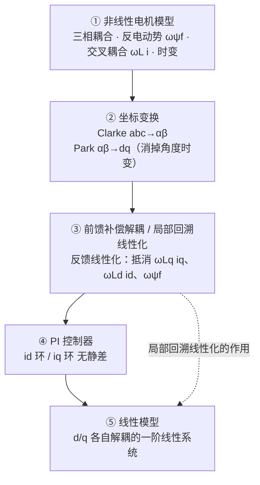
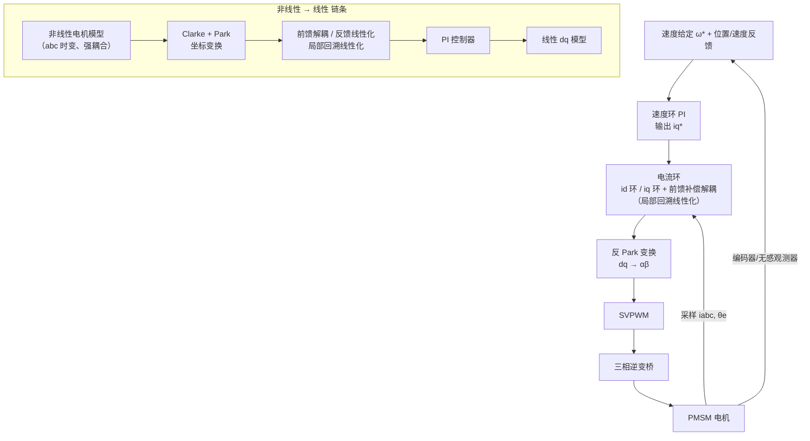

# FOC算法总结

> FOC（磁场定向控制 / 矢量控制）用坐标变换把三相交流量解耦成 dq 轴上的直流量，在 d 轴控制磁链、q 轴控制转矩，配上 PI 环与 SVPWM，是无刷直流（BLDC）与永磁同步电机（PMSM）高性能控制的基础框架。

## 摘要

FOC 的核心是**把旋转的磁场"定向"到与转子磁场同步的坐标系**，从而将三相强耦合、非线性、时变的电机模型，变换为两个独立的直流量控制通道。整条方法的本质可以压缩成一条链：

**非线性电机模型 → 坐标变换 / 前馈补偿解耦（局部回溯线性化）/ PI 控制器 → 线性模型**

即：**先把非线性系统"变"成线性系统，再让 PI 这种线性调节器去控制它**——PI 之所以能无静差工作，前提正是前面的坐标变换与解耦已经把对象线性化、解耦化了。实现链路为：采样三相电流 → Clarke 变换（abc→αβ）→ Park 变换（αβ→dq，依赖转子电角度）→ 电流环 PI（分别控 $i_d$、$i_q$）→ 反 Park 变换 → SVPWM 生成逆变器开关信号。外环可加转速环/位置环。对模型非线性明显、要求高动态的场合，可在电流环上叠加**反馈线性化（feedback linearization）**做输入-输出解耦补偿。无位置传感器时还需磁链观测器/滑模观测器/高频注入估计角度与速度。

## 原文要点

### 0. 核心链条：从非线性到线性

整个 FOC 框架可以看成一条**"非线性 → 线性"的变换链**：

| 环节 | 作用 | 消掉的是哪种"非线性" |
|---|---|---|
| ① 非线性电机模型 | 对象本身：三相电流耦合、含 $\omega\psi_f$ 与 $\omega L i$ 项、随角度时变 | 起点 |
| ② 坐标变换（Clarke + Park） | 交流量 → 直流量，abc 三轴 → d/q 两轴 | **坐标/时变非线性**（角度旋转、三相耦合） |
| ③ 前馈补偿解耦（局部回溯线性化 / 反馈线性化） | 用 $\omega L_q i_q$、$\omega L_d i_d$、$\omega\psi_f$ 等补偿项在控制输入里把非线性项抵消 | **状态耦合非线性**（$\omega$、$i$ 的乘积项） |
| ④ 控制器 | 在已线性化的对象上做 PI / 极点配置 | —— |
| ⑤ 线性模型 | $\dfrac{di_d}{dt}=\dfrac{1}{L_d}(u_d-Ri_d)$、$\dfrac{di_q}{dt}=\dfrac{1}{L_q}(u_q-Ri_q)$ | 终点：可设计、可无静差 |

- 一句概括：**非线性模型 →（坐标变换 + 前馈解耦/局部回溯线性化 + PI）→ 线性模型**；链中②③两步是"线性化器"，④只是"线性控制器"。
- **"局部"的含义**：反馈线性化的精确性依赖 $L_d$、$L_q$、$\psi_f$、$\omega$ 等参数，且通常只在工作点附近近似成立，故称局部；参数失配时解耦退化，反馈回路（PI）负责兜底鲁棒性。
- **两种层次**：②是"坐标系层面的解耦"（结构上把耦合项挪到同一坐标系里显式暴露），③是"控制律层面的解耦"（把这些显式项再算回控制量抵掉）。工程上的简化版就是**前馈解耦**，完整版即**反馈线性化**。

### 1. 基本思想

- 三相电流在静止坐标系下是交流量，且相互耦合，难以直接用 PI 做无静差控制。
- 把定子电流矢量投影到**随转子磁场同步旋转的 dq 坐标系**：
  - $d$ 轴（励磁轴）：控制磁链；
  - $q$ 轴（转矩轴）：控制转矩。
- 变换后 $i_d$、$i_q$ 在稳态是**直流量**，可用 PI 实现无静差，转矩与 $i_q$ 近似线性。

### 2. 坐标变换

**Clarke（abc → αβ，恒幅值）：**

$$\begin{bmatrix} i_\alpha \\ i_\beta \end{bmatrix}
= \frac{2}{3}\begin{bmatrix} 1 & -\frac12 & -\frac12 \\ 0 & \frac{\sqrt3}{2} & -\frac{\sqrt3}{2} \end{bmatrix}
\begin{bmatrix} i_a \\ i_b \\ i_c \end{bmatrix}$$

**Park（αβ → dq，角度为转子电角度 $\theta_e$）：**

$$\begin{bmatrix} i_d \\ i_q \end{bmatrix}
= \begin{bmatrix} \cos\theta_e & \sin\theta_e \\ -\sin\theta_e & \cos\theta_e \end{bmatrix}
\begin{bmatrix} i_\alpha \\ i_\beta \end{bmatrix}$$

反变换与反 Clarke 用于把 $v_d$、$v_q$ 变回三相调制电压。

### 3. 控制环结构

| 环路 | 输入 | 输出 | 作用 |
|---|---|---|---|
| 电流环（内环） | $i_d^*$、$i_q^*$ | $v_d$、$v_q$ | 带宽最高，电流跟随 |
| 转速环（中环） | $\omega^*$ | $i_q^*$ | 调速，输出转矩指令 |
| 位置环（外环） | $\theta^*$ | $\omega^*$ | 定位/伺服 |

- **$i_d^*$ 给定**：表贴式 PMSM（$L_d=L_q$）取 $i_d^*=0$（仅用永磁转矩）；要利用磁阻转矩（内置式 IPM）则按 MTPA 给负 $i_d^*$。
- 电流环典型用两个 PI：$i_d$ 环、$i_q$ 环，输出经**前馈解耦**抵消反电动势与交叉耦合项。

### 4. SVPWM（空间矢量脉宽调制）

- 用 6 个有效矢量 + 2 个零矢量合成目标电压矢量 $\vec v_{ref}$。
- 计算扇区、作用时间、七段式/五段式开关序列，比正弦 PWM 直流电压利用率高约 15%，谐波更低。
- 输出 6 路互补 PWM，带死区，驱动三相逆变桥。

### 5. 反馈线性化（feedback linearization）

电机在 dq 轴上的电流动态含**反电动势与交叉耦合**（非线性项 $\omega\psi$）：

$$\frac{di_d}{dt} = \frac{1}{L_d}(v_d - R i_d + \omega L_q i_q), \qquad
\frac{di_q}{dt} = \frac{1}{L_q}(v_q - R i_q - \omega L_d i_d - \omega\psi_f)$$

- **思想**：通过非线性状态反馈把原本非线性系统变换为**线性系统**，再用线性控制（PI/极点配置）设计。这种做法是典型的**局部回溯线性化（input-output linearization / exact feedback linearization 的工程化形态）**。
- **实现**：在 PI 输出上叠加解耦补偿项

$$v_d = R i_d + L_d\frac{di_d^*}{dt} - \omega L_q i_q + u_d,\qquad
v_q = R i_q + L_q\frac{di_q^*}{dt} + \omega L_d i_d + \omega\psi_f + u_q$$

其中 $u_d$、$u_q$ 为新系统的线性控制量（PI 输出）。这样 d/q 轴各自变成一阶线性系统，动态解耦、响应更快。

**为什么称"回溯线性化"？** 因为是通过**状态反馈 $v=f(i,\omega)+g\cdot u$** 把原先 $v$ 的非线性作用"回溯"到输入中，抵消掉系统固有的非线性项，剩下的映射 $u \mapsto \dot i$ 才是线性的。由于它只要求当前点的参数已知，这种线性化是**局部精确**的（依赖工作点参数）。
- **注意**：依赖准确的 $L_d$、$L_q$、$\psi_f$、$\omega$；参数误差会削弱解耦效果。工程上常做简化版"**前馈解耦**"（省去 $L\dot i^*$ 前馈或用稳态近似）。如果完全不做这一步，PI 还要"与"耦合项周旋，动态衰减与抗扰能力都受限。

### 6. 无位置传感器控制（无感 FOC）

| 方法 | 原理 | 适用 |
|---|---|---|
| 磁链观测器 / 电压模型 | 由 $\psi=\int(v-Ri)dt$ 积分估磁链得角度 | 中高速 |
| 滑模观测器（SMO） | 反电动势估计 + 锁相环 | 中高速，鲁棒 |
| 扩展/龙伯格观测器 | 状态估计 | 中高速 |
| 高频注入 | 凸极效应 | 零/低速 |
| 非线性磁链观测器 | 以磁链为状态，抗积分漂移 | 宽速域 |

### 7. 弱磁与 MTPA

- **MTPA（最大转矩电流比）**：用最小电流给定额定转矩，$i_d<0$ 利用磁阻转矩。
- **弱磁控制**：电压受限 $|v|\le V_{max}$，高速时反电动势 $\omega\psi_f$ 升高，需注入负 $i_d$ 削弱磁链以继续升速（电压/电流极限圆交点）。

### 8. 关键参数与整定

- 电流环带宽：一般取开关频率的 1/10 左右；PI 增益按 $L$、$R$ 设计，使环路近似一阶。**设计前提是对象已经完成解耦与线性化**（步骤②③），否则基于 $L/R$ 的一阶整定模型是有偏差的。
- 速度环带宽：约为电流环的 1/5～1/10。
- 采样与角度延迟需补偿（1.5 个采样周期延迟常见）。
- 关注死区、电流采样（单/双/三电阻）、母线电压前馈。

### 9. 控制链路示意

## 个人想法

把 FOC 看成**"先线性化，再线性控制"**最贴切：坐标变换处理了时变与三相耦合，前馈补偿/反馈线性化（局部回溯线性化）处理了 d-q 间的交叉耦合与反电动势，最后 PI 才能在两个独立一阶直流系统上无静差地工作。简言之：**非线性电机模型 → 坐标变化/前馈补偿解耦（局部回溯线性化）/ PI 控制器 → 线性模型**。

## 原文链接

笔记整理
